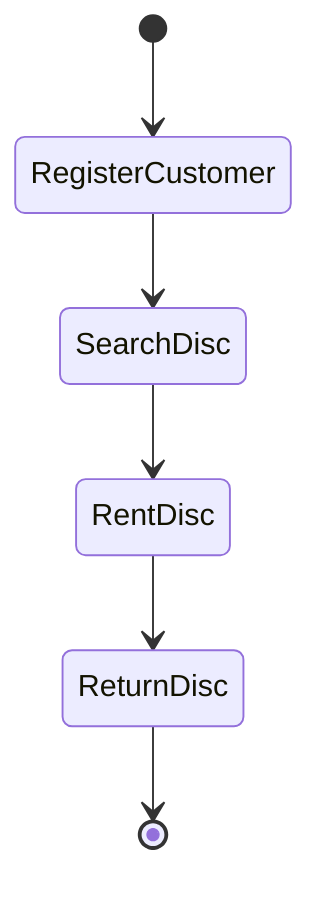

# Disc Rental Service System

## 1. Analysis Method

A comprehensive approach for analyzing the disc rental system is **Object-Oriented Analysis (OOA)** combined with **UML modeling** and process mapping. This method is ideal for systems with distinct real-world entities and complex interactions.

**Justification:**
- The system involves entities such as customers, discs, suppliers, rentals, and orders.
- OOA enables clear representation of these entities as objects/classes, with defined attributes and relationships.
- UML diagrams (Use Case, Class, Activity, Sequence) provide visual clarity for system structure and behavior.
- Process mapping ensures all business workflows are captured.

---

# Mermaid Diagrams

## Use Case Diagram

```mermaid
graph TD
    Customer -->|register| System
    Customer -->|rent disc| System
    Customer -->|return disc| System
    Staff -->|manage customers| System
    Staff -->|manage discs| System
    Staff -->|generate reports| System

**Justification:**
1. Real-world entities (Customer, Disc, Supplier, Rental, Order) are naturally modeled as objects/classes.
2. OOA groups data and behavior, making the system easier to design, understand, and extend.
3. The system is scalable and compatible with modern development practices.
4. UML diagrams provide clear graphical representation of structure and behavior.

classDiagram
# 2. Why is the Event List Necessary?

The **event list** identifies all important interactions between users and the system. It helps to:
- Identify system processes
- Define system functionality
- Build use cases
- Ensure all system behaviors are considered
Events represent things that happen in the system that require a response.

---
    Customer <|-- Rental
# 3. Event List

## Customer Events
- Customer registers
- Customer updates personal data
- Customer rents a disc
- Customer returns a disc

## Disc Events
- Owner adds a new disc
- Owner updates disc information
- Owner marks disc as damaged
- System checks disc availability

## Rental Events
- Owner records rental
- Owner records return
- System checks overdue rentals

## Supplier Events
- Owner adds supplier
- Owner creates disc order
- Supplier delivers discs

## Reporting Events
- System generates customer list
- System generates disc inventory list
- System generates rental report
- System generates damaged disc list
- System generates debtor list
- System calculates average rental time

---
    Disc <|-- Rental
    Supplier <|-- Order
    DiscType <|-- Disc
    class Customer {
        customer_id
        name
        address
        phone
        rental_card
    }
    class Disc {
        disc_id
        title
        type_id
        supplier_id
    Owner -->|register customer| System
    Owner -->|manage discs| System
    Owner -->|rent disc| System
    Owner -->|return disc| System
    Owner -->|manage suppliers| System
    Owner -->|order discs| Supplier
    Owner -->|generate reports| System
    Customer -->|register| System
    Customer -->|rent disc| System
    Customer -->|return disc| System
    Supplier -->|deliver discs| System
        status
    }
    class DiscType {
        type_id
        type_name
    }
    class Rental {
        rental_id
        customer_id
        disc_id
        rental_date
        return_date
        status
    }
    class Supplier {
        supplier_id
        supplier_name
        address
        phone
    }
    class Order {
        order_id
        supplier_id
        disc_type
        quantity
        order_date
        delivery_status
    }
```

## Activity Diagram (Rental Process)



---

# 2. System Requirements

## Functional Requirements

The system must allow:
1. Registration and management of customers
2. Maintaining a detailed disc catalog
    class Order {
        order_id
        supplier_id
        disc_type
        quantity
        order_date
        delivery_status
    }
    Customer --> Rental : makes
    Rental --> Disc : includes
    Disc --> DiscType : belongs to
    Supplier --> Disc : supplies
    Supplier --> Order : fulfills
3. Recording disc rentals and returns
4. Tracking damaged and overdue discs
5. Managing suppliers and their deliveries
6. Creating and tracking orders for new discs
7. Generating annual, monthly, and custom reports
8. Searching and filtering discs and customers
9. Calculating rental statistics and average rental duration
10. Identifying debtors and rental history

## Non-Functional Requirements

    [*] --> CustomerRequestsDisc
    CustomerRequestsDisc --> SystemChecksAvailability
    SystemChecksAvailability --> OwnerRecordsRental
    OwnerRecordsRental --> SystemUpdatesDiscStatus
    SystemUpdatesDiscStatus --> SystemStoresRentalRecord
    SystemStoresRentalRecord --> [*]
1. Persistent data storage in a secure database
2. Fast and efficient search functionality
4. User-friendly interface for staff and customers
5. Support for report generation and export
6. Scalability for future expansion
The system is described using **UML (Unified Modeling Language)**.

**UML Components:**
1. Use Case Diagram
2. Class Diagram
3. Activity Diagram
4. Sequence Diagram (optional)

**Justification:**
UML is widely used for object-oriented system design and provides clear graphical representation of system structure and behavior.
    - Track disc availability and status
3. Rental management
    - Register rental
    - Register return
    - Record rental history
    - Monitor overdue rentals
Responsibilities: rent discs, return discs
Relationship: one customer can have many rentals
    - Add, update, delete supplier
5. Order management
    - Create order for new discs
    - Track order status and delivery
Responsibilities: store disc information, track availability
Relationship: belongs to one disc type
    - Generate statistics (e.g., average rental duration)
    - Create annual/monthly/custom reports
    - Export reports
7. Security and audit
Responsibilities: categorize discs
Relationship: one type can include many discs


# 4. Objects in the System

Responsibilities: store rental transaction, track rental and return dates
Relationship: linked to one customer, linked to one disc
**Justification:** Customers are the main users and must be tracked for rentals, returns, and debt management.
## Disc
Represents an individual disc available for rental.
**Justification:** Discs are the primary inventory items; their status and history must be managed.
Responsibilities: deliver discs
Relationship: one supplier can fulfill many orders
Represents the category of a disc (music, movie, software).

## Rental
Represents the act of borrowing a disc by a customer.
Responsibilities: record disc purchase requests, track order status
Relationship: linked to a supplier
## Supplier
**Justification:** Suppliers are tracked for inventory and order management.

## Order
Using **object-oriented analysis and UML diagrams** allows the Disc Rental System to be modeled clearly. The system events, objects, relationships, and responsibilities define a solid foundation for future implementation.

# 5. Goal of the System

The goal is to **support and optimize the management of a disc rental service** by:
- Organizing information about customers, discs, suppliers, rentals, and orders
- Managing rentals, returns, and overdue items
- Monitoring disc availability, damage, and inventory
- Generating comprehensive reports and statistics
- Ensuring data integrity, security, and auditability
- Providing a scalable and user-friendly platform

---

# 6. List of System Functions

1. Registering and managing customers
2. Managing the disc inventory
3. Recording rentals and returns
4. Monitoring overdue rentals and debtors
5. Identifying damaged discs
6. Managing suppliers
7. Creating and tracking disc orders
8. Generating statistical, administrative, and custom reports
9. Searching/filtering data
10. Logging and auditing all transactions

---

# 7. Data Dictionary

## Customer
| Attribute     | Description                       |
| ------------- | ----------------------------------- |
| customer_id   | Unique identifier of the customer   |
| name          | Customer name                      |
| address       | Customer address                   |
| phone         | Contact phone number               |
| rental_card   | Record of customer's rentals       |
| email         | Customer email address             |
| registration_date | Date of registration            |

---

## Disc
| Attribute     | Description                         |
| ------------- | ------------------------------------ |
| disc_id       | Unique identifier of the disc        |
| title         | Title of the disc                    |
| type_id       | Type of disc (music/movie/software)  |
| supplier_id   | Supplier of the disc                 |
| status        | Availability status (available/rented/damaged) |
| location      | Physical location in store           |
| price         | Rental price                         |

---

## DiscType
| Attribute   | Description                        |
| ----------- | ---------------------------------- |
| type_id     | Unique identifier of the disc type  |
| type_name   | Name of the disc type               |
| description | Description of the disc type        |

---

## Rental
| Attribute     | Description                       |
| ------------- | ---------------------------------- |
| rental_id     | Unique identifier of the rental    |
| customer_id   | Customer who rented the disc       |
| disc_id       | Rented disc                        |
| rental_date   | Date of rental                     |
| return_date   | Date of return                     |
| status        | Returned / overdue                 |
| fee           | Rental fee                         |
| penalty       | Penalty for overdue/damage         |

---

## Supplier
| Attribute       | Description                      |
| --------------- | -------------------------------- |
| supplier_id     | Unique supplier identifier        |
| supplier_name   | Name of the supplier              |
| address         | Supplier address                  |
| phone           | Contact phone number              |
| email           | Supplier email address            |
| contact_person  | Main contact person               |

---

## Order
| Attribute         | Description                     |
| ----------------- | ------------------------------ |
| order_id          | Unique order identifier         |
| supplier_id       | Supplier fulfilling the order   |
| disc_type         | Type of disc ordered            |
| quantity          | Number of discs ordered         |
| order_date        | Date of order                   |
| delivery_status   | Delivery status                 |
| expected_delivery | Expected delivery date          |

---

# 8. Extended Features and Recommendations

- Integration with online rental platform
- Automated notifications for overdue rentals
- Barcode scanning for disc management
- Role-based access control for staff
- Data backup and recovery
- Analytics dashboard for business insights

---

# Conclusion

This enhanced system design provides a robust, scalable, and feature-rich solution for disc rental management. It covers all mandatory elements, expands on requirements, and introduces advanced features for future growth and operational excellence.
