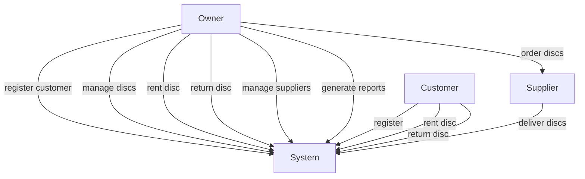
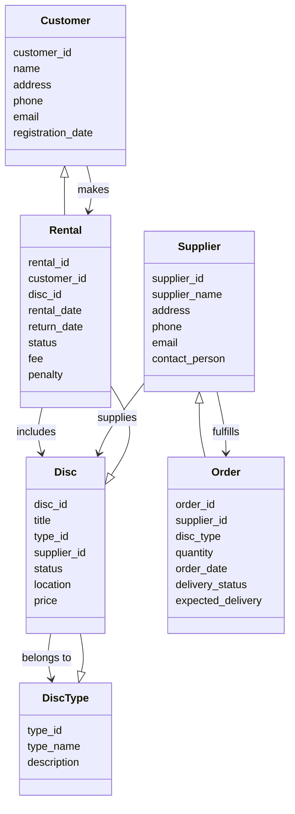
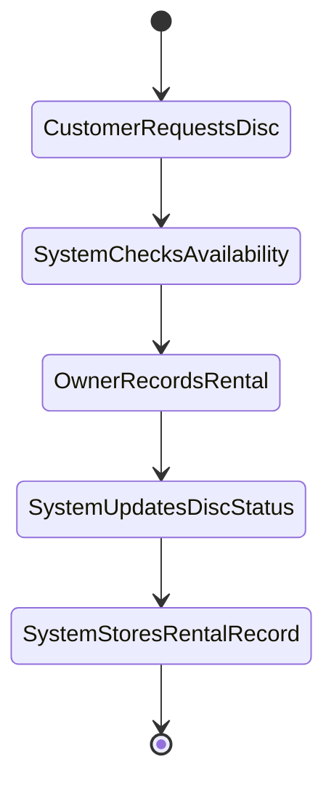

# Disc Rental Service System --- Model Solution (Stage II)

## Final Choice of System Analysis Method

The **Object-Oriented Analysis (OOA)** method was chosen instead of the
structured analysis method.

### Justification

The system contains clearly identifiable real-world entities such as: -
Customer - Disc - Supplier - Rental

These entities naturally correspond to **objects or classes** in
object-oriented modeling.\
This makes the system easier to design, understand, and extend.

------------------------------------------------------------------------

# 1. Why was this method chosen?

Object-oriented analysis was selected for the following reasons:

1.  **Natural representation of real-world entities**\
    Customers, discs, suppliers, and rentals can be directly modeled as
    classes.

2.  **Better organization of the system**\
    Data and behavior are grouped together inside objects.

3.  **Scalability**\
    The system can be easily expanded with new functionality.

4.  **Modern development compatibility**\
    Most modern programming languages support object-oriented design.

------------------------------------------------------------------------

# 2. Why is the event list necessary?

The **event list** identifies all important interactions between users
and the system.

It helps to:

-   identify system processes
-   define system functionality
-   build use cases
-   ensure that all system behaviors are considered

Events represent **things that happen in the system** that require a
response.

------------------------------------------------------------------------

# 3. Event List

### Customer Events

-   Customer registers
-   Customer updates personal data
-   Customer rents a disc
-   Customer returns a disc

### Disc Events

-   Owner adds a new disc
-   Owner updates disc information
-   Owner marks disc as damaged
-   System checks disc availability

### Rental Events

-   Owner records rental
-   Owner records return
-   System checks overdue rentals

### Supplier Events

-   Owner adds supplier
-   Owner creates disc order
-   Supplier delivers discs

### Reporting Events

-   System generates customer list
-   System generates disc inventory list
-   System generates rental report
-   System generates damaged disc list
-   System generates debtor list
-   System calculates average rental time

------------------------------------------------------------------------

# 4. System Description Model

The system is described using **UML (Unified Modeling Language)**.

### UML Components

1.  **Use Case Diagram**
2.  **Class Diagram**
3.  **Activity Diagram**
4.  **Sequence Diagram** (optional)

### Justification

UML is widely used for **object-oriented system design** and provides
clear graphical representation of system structure and behavior.

---

## Mermaid Diagrams

### Use Case Diagram

### Class Diagram

### Activity Diagram (Disc Rental Process)

------------------------------------------------------------------------

# 5. Required Diagrams

## Use Case Diagram

Actors: - Owner - Customer

Main Use Cases: - Register customer - Manage discs - Rent disc - Return
disc - Manage suppliers - Order discs - Generate reports

------------------------------------------------------------------------

## Class Diagram

Main classes: - Customer - Disc - DiscType - Rental - Supplier - Order

Relationships:

-   Customer → makes → Rental
-   Rental → includes → Disc
-   Disc → belongs to → DiscType
-   Supplier → supplies → Disc
-   Supplier → fulfills → Order

------------------------------------------------------------------------

## Activity Diagram

Example: **Disc Rental Process**

Steps: 
1. Customer requests disc 
2. System checks availability
3. Owner records rental 
4. System updates disc status 
5. System stores rental record

------------------------------------------------------------------------

# 6. Objects, Relationships, and Responsibilities

## Customer

Responsibilities: - rent discs - return discs

Relationship: - one customer can have many rentals

------------------------------------------------------------------------

## Disc

Responsibilities: - store disc information - track availability

Relationship: - belongs to one disc type

------------------------------------------------------------------------

## DiscType

Responsibilities: - categorize discs

Relationship: - one type can include many discs

------------------------------------------------------------------------

## Rental

Responsibilities: - store rental transaction - track rental and return
dates

Relationship: - linked to one customer - linked to one disc

------------------------------------------------------------------------

## Supplier

Responsibilities: - deliver discs

Relationship: - one supplier can fulfill many orders

------------------------------------------------------------------------

## Order

Responsibilities: - record disc purchase requests - track order status

Relationship: - linked to a supplier

------------------------------------------------------------------------

# Conclusion

Using **object-oriented analysis and UML diagrams** allows the Disc
Rental System to be modeled clearly.\
The system events, objects, relationships, and responsibilities define a
solid foundation for future implementation.
